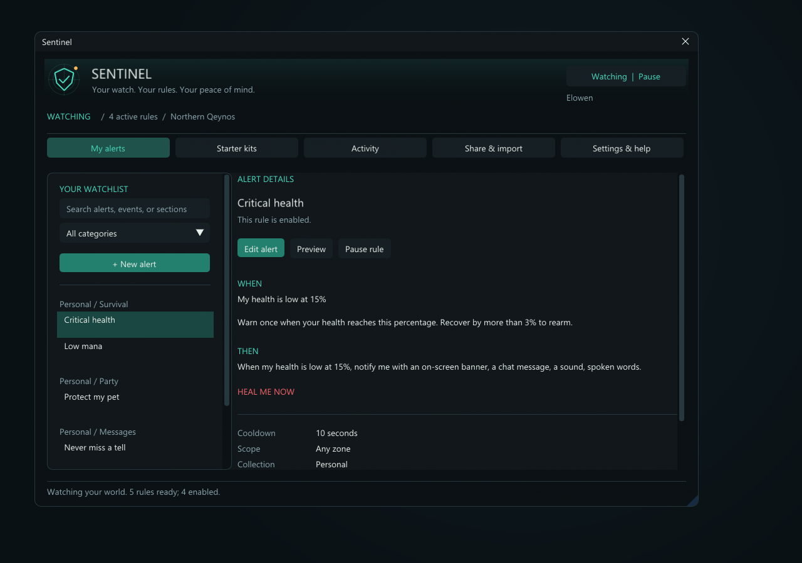
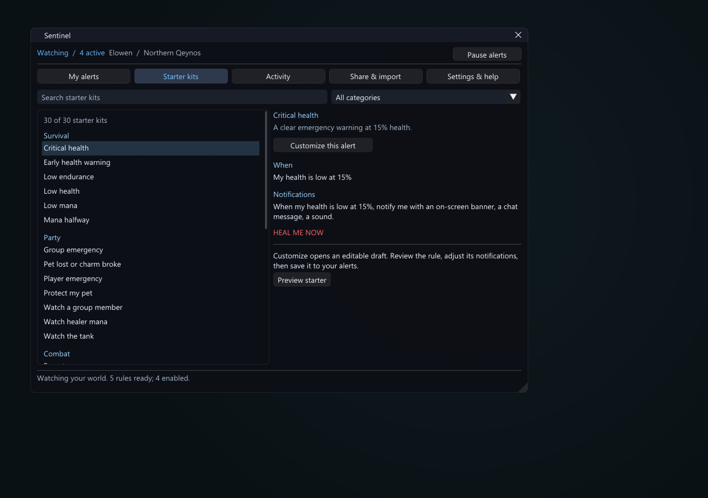

# Sentinel for Hailstone

**A calmer way to keep watch.** Sentinel turns the moments you care about into clear, personal alerts: low health, a fading buff, a lost pet, a dangerous cast, or a message you do not want to miss.

It is a standalone addon. Your custom DLL is not required.



Starter kits now use a compact, searchable list:



## Get started

1. Open **Add-ons** on Hailstone's login screen.
2. Paste `https://github.com/fryguy503/hailstone-sentinel`, inspect the package, and install it.
3. Enter the world and load the plugin with `/plugin sentinel`.
4. Open **Sentinel alerts** from the game menu, or type `/sentinel`.
5. Choose **Starter kits**, customize an alert, and press **Preview** before saving.

Packages are available for **Windows x64**, **Linux x64**, and **macOS Apple Silicon (arm64, macOS 13.3 or newer)**, for Hailstone **0.7.0-beta or newer** using SDK ABI 3. The addon manager chooses your platform automatically. The addon manifest is unsigned; the Mac library is ad-hoc signed and is not notarized. If Hailstone cannot find a preview release automatically, paste that release's tag link from the repository's Releases page. Use Hailstone's Plugins controls to keep the plugin enabled for your character.

## Make it yours

- **23 event types.** Health, mana, endurance, party and pet warnings, buffs, nearby spawns, target casts, chat channels, custom text patterns, fizzles, resists, and invisibility warnings.
- **A guided rule builder.** Choose a trigger, pick notification styles, and read a plain-language summary before saving.
- **A familiar, compact window.** Follows your active client theme and palette. Starter kits use a searchable list with details for the selected preset.
- **A searchable library.** Organize up to 128 alerts with categories, sections, subsections, and optional zone restrictions.
- **Notifications that fit the moment.** Colored banners in five sizes, local chat, five built-in chimes, custom WAV files, and platform speech.
- **A comfortable HUD.** Move the banner stack, lock it in place, or mute audio with Quiet mode. Master Pause stops automatic alerts while preserving your library.
- **Remembered window visibility.** Sentinel opens on first use, then keeps your last open or closed state through zoning and reloads.
- **Activity history.** Review the last 100 notifications, with previews clearly marked.
- **Reviewed sharing.** Export one rule or the library as text. Inspect incoming rules before adding them; imports always begin disabled.
- **Separate character settings.** Each server and character has its own library. Nothing is written to your game assets folder.

Sentinel only observes and notifies. It does not cast, target, move, send chat to other players, or change game mechanics. Its declared permissions are `read,commands,events,ui`.

## A few examples

| I want to know when… | Start with… |
| --- | --- |
| My health reaches 15% | Emergency heal |
| A group member reaches 35% health | Group emergency |
| My buff has 30 seconds left | Refresh a buff |
| My pet disappears or charm breaks | Pet lost or charm broke |
| My target begins casting | Interrupt a spell |
| Someone sends me a tell | Never miss a tell |
| A chat line reports a large hit | Custom text pattern |

Percentage rules alert once when the threshold is reached. They rearm after recovery above the threshold plus three percentage points. A cooldown limits notifications; it does not repeat an alert while a condition remains true. Group members and targets are tracked independently. Logging in without a pet does not trigger a lost-pet warning.

## Text patterns and messages

Chat patterns match the **whole line**, ignoring ASCII letter case. Add `*` around text to find it anywhere.

| Pattern | Meaning |
| --- | --- |
| `*rampage*` | Any line containing rampage |
| `{S1} hits {C} for {N1>=1000} points of damage.` | Capture the attacker and damage, only for hits of 1,000 or more |
| `*{S1} tells you, '{S2}'` | Capture text from a tell-shaped line |

`*` matches any text, `?` matches one character, `{S1}` captures text, and `{N1}` captures a number. Numeric captures accept `=`, `!=`, `<`, `<=`, `>`, and `>=` comparisons, signed numbers, decimals, and comma separators.

In messages or speech, use `{C}` for your character, `{L}` for the matching line or state description, `{COUNTER}` for the rule's firing count, and captures such as `{S1}` and `{N1}`. Leave the message empty for an automatic description.

## Sounds, speech, and sharing

Place custom WAV files in **Sounds beside your character's Sentinel `config.json`**, then click **Rescan sounds**. Settings & help shows the exact settings path. Supported WAVs are PCM 16-bit, mono or stereo, 8–96 kHz, at most 30 seconds and 16 MiB. An unreadable WAV falls back to a built-in tone. Each rule has its own volume.

Chimes and custom WAV playback work on all three platforms. Windows uses its native audio APIs; Linux and macOS use the bundled miniaudio backend with the system's output device. Audio availability reflects whether an output device can be opened.

Speech uses installed system voices on Windows and macOS, with adjustable volume, rate, and optional separate wording. Linux speech is optional: install `espeak-ng` (or `espeak`) with your distribution's package manager. The default voice is the utility's default; Alternate uses its English `en+f3` variant. Linux invokes the utility directly without a shell and stops only its own speech process when an alert is cancelled. Missing speech support leaves the other notification outputs available.

In **Share & import**, select export text and use Ctrl+C. Paste a shared collection with Ctrl+V, choose **Review import**, and add the reviewed alerts. Enable each imported rule after checking it. Sharing uses ordinary text and does not require Bastion's server-specific raid-sharing protocol. Imports contain data only and cannot run commands or code.

Existing DLL users can convert a **copy** of their Citadel character INI with [the migration tool](tools/convert_legacy.py), then review its JSON through Share & import:

```powershell
python tools/convert_legacy.py path/to/CitadelCharacter.ini --out sentinel-import.json
```

## Commands

| Command | Action |
| --- | --- |
| `/sentinel` | Open Sentinel |
| `/sentinel on`, `off`, `toggle` | Control all automatic alerts |
| `/sentinel hide` | Close the library |
| `/sentinel list` | List your alerts and their numbers |
| `/sentinel test 2` | Preview alert number 2 |

## What to expect from the preview

The addon has automated rule, SDK adapter, persistence, import, audio-data, speech-process, and UI checks, plus rendered UI verification. CI builds and tests native Windows x64, Linux x64, and macOS arm64 packages. **Live gameplay and audible output acceptance on actual Linux and Mac systems are still needed.**

Sentinel uses information the server supplies. Other players' mana may be unavailable; absent readings are ignored. Group checks cover members present in your zone. Target casts are sampled every 100 ms, so a very short cast may be missed. Channel alerts recognize the standard English chat envelopes because Hailstone 0.7 passes RGB rather than channel metadata to native chat callbacks. Custom patterns can be used for localized text.

The DLL's binary raid-sharing packets and INI files are not read automatically. The migration tool creates a portable import and leaves the source untouched. Settings that cannot be read are preserved and reported instead of overwritten.

For building, packaging, testing, and architecture, see [Building](docs/BUILDING.md) and [Validation](docs/VALIDATION.md). MIT licensed; dependency notices are in [THIRD_PARTY.md](THIRD_PARTY.md).
